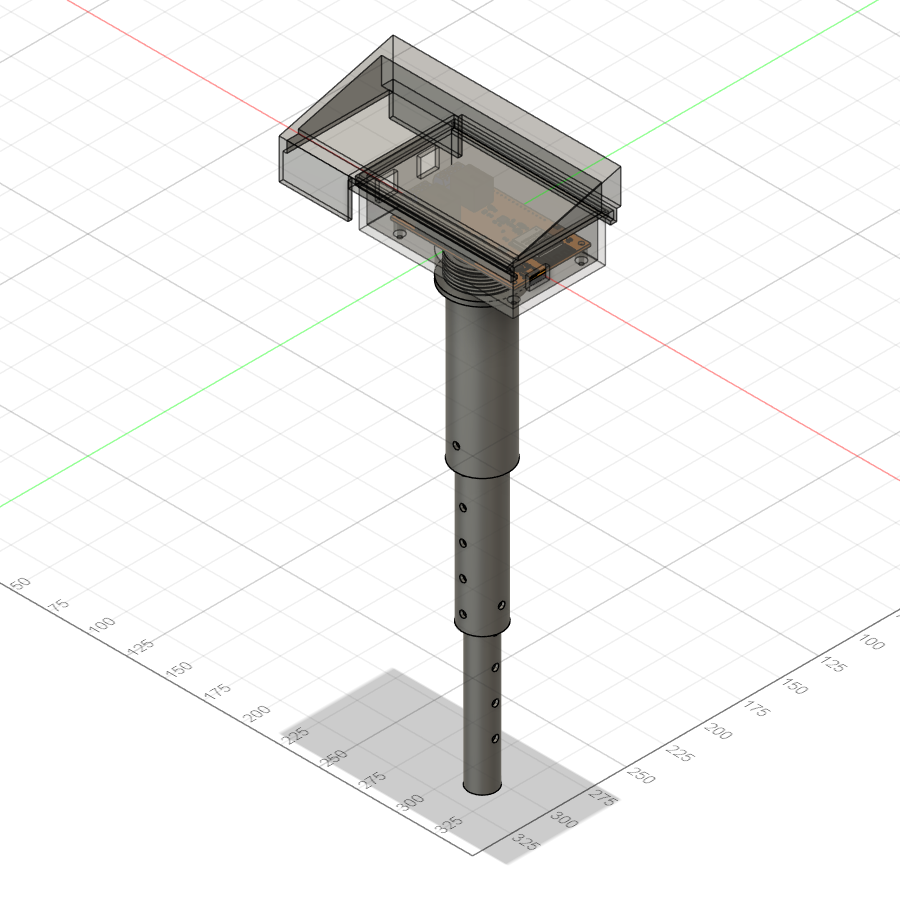
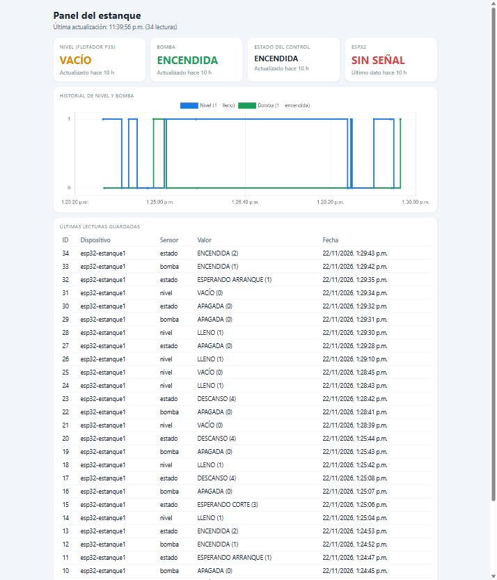

# Llenado automático de estanque — ESP32 + Railway + Aiven



Proyecto de **TEI201 Introducción al Diseño en Ingeniería**, Universidad Adolfo Ibáñez (2026).

**Página publicada:** https://esp32-railway-estanque-production.up.railway.app

## Equipo

| Integrante | Rol |
|---|---|
| **POR COMPLETAR** | Software y documentación técnica |
| **POR COMPLETAR** | Hardware y electrónica |
| **POR COMPLETAR** | Diseño 3D |
| **POR COMPLETAR** | Testing y datos |
| **POR COMPLETAR** | Líder y repositorio |

## ODS y problema

**ODS:** **POR COMPLETAR** (por ejemplo, ODS 6: Agua limpia y saneamiento).

**Problema:** un estanque de 2000 litros se llena con una bomba que hay que encender y
apagar a mano. Si nadie la apaga, el estanque rebalsa y se pierde agua; si nadie la
enciende, el estanque queda vacío. **POR COMPLETAR:** contexto real (dónde está el
estanque, quién lo usa y cuánta agua o tiempo se pierde).

## Descripción

Un **ESP32** lee un **flotador P35** instalado en el estanque y controla la **bomba**
mediante un **relé**: la enciende cuando el estanque se vacía y la apaga cuando se llena.
Un retardo de 10 s y un descanso de 60 s evitan que la bomba prenda y apague muchas veces.
El ESP32 envía el nivel, el estado de la bomba y el del control a un servidor en
**Railway**, que los guarda en **PostgreSQL (Aiven)** y los muestra en una página pública.

```
ESP32 (flotador P35 + relé) --POST HTTPS--> Railway (Express + página) --SQL con SSL--> Aiven (PostgreSQL)
        │                                            ▲
        └── página local (mismo WiFi)                └── celular o PC desde cualquier lugar
```



## Estado

| | |
|---|---|
| Versión | Iteración 3 (22-11-2026) |
| Funciona | Control de la bomba, página local, envío a Railway, base de datos y dashboard público |
| Falta | Fotos reales, BOM con precios, pruebas formales con 5 usuarios, reporte y presentación |

## Resultados clave

| Resultado | Valor | Origen |
|---|---|---|
| Lecturas guardadas en la prueba de puesta en marcha | 34 (respuestas 201) | [`testing/datos/`](testing/datos/) |
| Retardo antes de encender la bomba | ≈ 10 s, igual al programado | [`testing/reportes/reporte_testing.md`](testing/reportes/reporte_testing.md) |
| Descanso del motor tras cortar | 60 s verificado | Ídem |
| Aviso si la placa deja de enviar | SIN SEÑAL tras 3 min, verificado | [Captura](software/docs/img/dashboard_railway_2026-11-22.jpg) |
| Piezas del encapsulado | 7, todas ≤ 100 mm | [`diseno_3d/`](diseno_3d/) |
| Uso de memoria del firmware | 84 % del programa, 16 % de RAM | [`software/librerias/`](software/librerias/) |

## Estructura del repositorio

```
README.md              este archivo
FUENTES.md             fuentes, librerías, servicios y uso de IA
LICENSE                MIT
server.js              servidor Express (en la raíz para que Railway lo encuentre)
package.json           dependencias de Node
.env.example           plantilla de variables (sin claves)
public/                página web publicada
esp32/esp32_railway/   firmware del ESP32
software/              documentación del software (README, docs/, librerias/)
hardware/              README, esquemas/, bom/, fotos/
diseno_3d/             README, stl/, renders/, fusion360/, planos/
testing/               README, reportes/, datos/, evidencias/
iteraciones/           README, iteracion_1/, iteracion_2/, iteracion_3/
documentacion/         reporte_final/, presentacion/
```

## Dónde está cada criterio de la rúbrica

| Dimensión | Peso | Criterio | Dónde está |
|---|---|---|---|
| Software | 30 % | Captura de datos | [`software/docs/captura_y_datos.md`](software/docs/captura_y_datos.md) §1 |
| | | Repositorio de datos | [`software/docs/captura_y_datos.md`](software/docs/captura_y_datos.md) §2, [`software/docs/api.md`](software/docs/api.md) |
| | | Dashboard y visualización | [`public/index.html`](public/index.html), [página publicada](https://esp32-railway-estanque-production.up.railway.app) |
| | | Generación de información | [`software/docs/captura_y_datos.md`](software/docs/captura_y_datos.md) §3 |
| | | Calidad del código | [`software/README.md`](software/README.md), [`server.js`](server.js), [`esp32_railway.ino`](esp32/esp32_railway/esp32_railway.ino) |
| | | Fuentes (habilitante) | [`FUENTES.md`](FUENTES.md) |
| Hardware | 30 % | Selección de componentes | [`hardware/README.md`](hardware/README.md) |
| | | Esquemático y BOM | [`hardware/esquemas/`](hardware/esquemas/), [`hardware/bom/`](hardware/bom/) |
| | | Montaje físico | [`hardware/fotos/`](hardware/fotos/) |
| | | Diseño para la reparación | [`hardware/README.md`](hardware/README.md#diseño-para-la-reparación) |
| Diseño 3D | 20 % | Gemelo 3D y modelado en Fusion 360 | [`diseno_3d/fusion360/`](diseno_3d/fusion360/), [`diseno_3d/stl/`](diseno_3d/stl/) |
| | | Funcionalidad del encapsulado | [`diseno_3d/README.md`](diseno_3d/README.md) |
| | | Planos técnicos | [`diseno_3d/planos/`](diseno_3d/planos/) |
| | | Renders | [`diseno_3d/renders/`](diseno_3d/renders/) |
| Testing | 10 % | Protocolo de pruebas | [`testing/reportes/protocolo_pruebas.md`](testing/reportes/protocolo_pruebas.md) |
| | | Análisis de resultados y validación | [`testing/reportes/reporte_testing.md`](testing/reportes/reporte_testing.md) |
| GitHub | 5 % | Estructura y respaldo | Este repositorio, [historial de commits](https://github.com/mcandela123/esp32-railway-estanque/commits/main), [`iteraciones/`](iteraciones/) |
| Presentación | 5 % | Claridad, demo y preguntas | [`documentacion/presentacion/`](documentacion/presentacion/) |

## Inicio rápido

1. Clonar el repositorio.
2. Servidor: copiar `.env.example` a `.env` con los datos de Aiven y la `API_KEY`, y
   luego `npm install` y `npm start`.
3. ESP32: abrir `esp32/esp32_railway/esp32_railway.ino` en Arduino IDE 2 y completar
   la sección 1 (redes WiFi, URL de Railway, `API_KEY`). Placa **ESP32 Dev Module**,
   librería **ArduinoJson 7**, y subir.
4. Abrir la URL de Railway o, en el mismo WiFi, la dirección que muestra el Monitor Serie.

Guía completa: [`software/README.md`](software/README.md).

## Checklist de entrega

- [x] `FUENTES.md` en la raíz
- [x] Ninguna clave en el repositorio ni en el historial (revisado el 22-11-2026)
- [x] Página en Railway funcionando
- [x] Diagrama de conexiones
- [ ] BOM con precios y enlaces reales
- [ ] Fotos reales del prototipo
- [x] STL de las 7 piezas, `.f3d` que abre, 3 láminas con cotas, vistas ortogonales y 4 renders
- [x] Protocolo de pruebas redactado antes de las pruebas formales
- [ ] Pruebas formales con datos reales y 5 usuarios
- [x] Iteraciones con fechas reales
- [ ] Integrantes, roles y ODS en este README
- [ ] Reporte (máximo 15 páginas) y presentación (10 min) en `documentacion/`
- [ ] Commits de todos los integrantes
- [ ] Todos los enlaces probados en una ventana de incógnito

## Licencia

[MIT](LICENSE)
