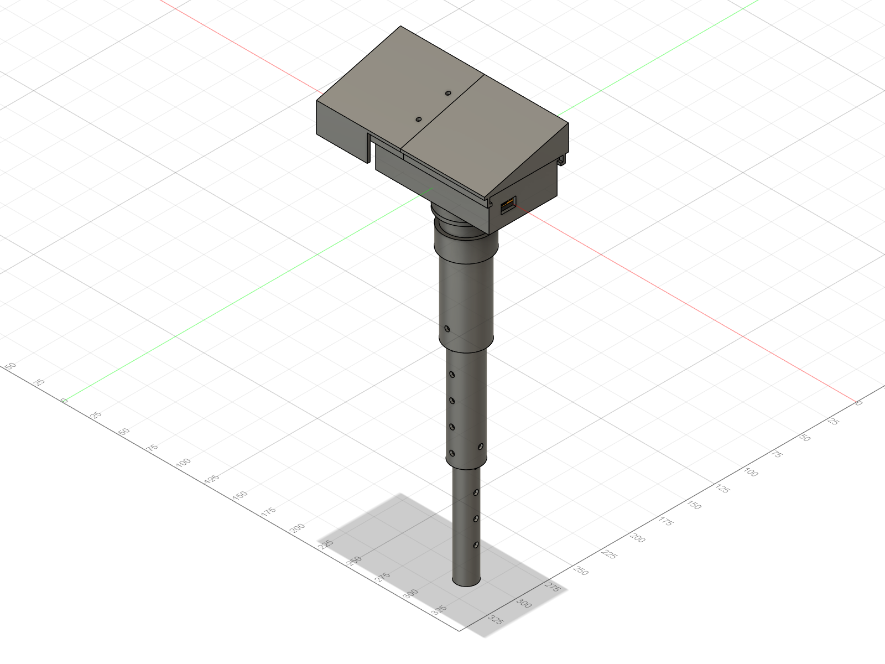
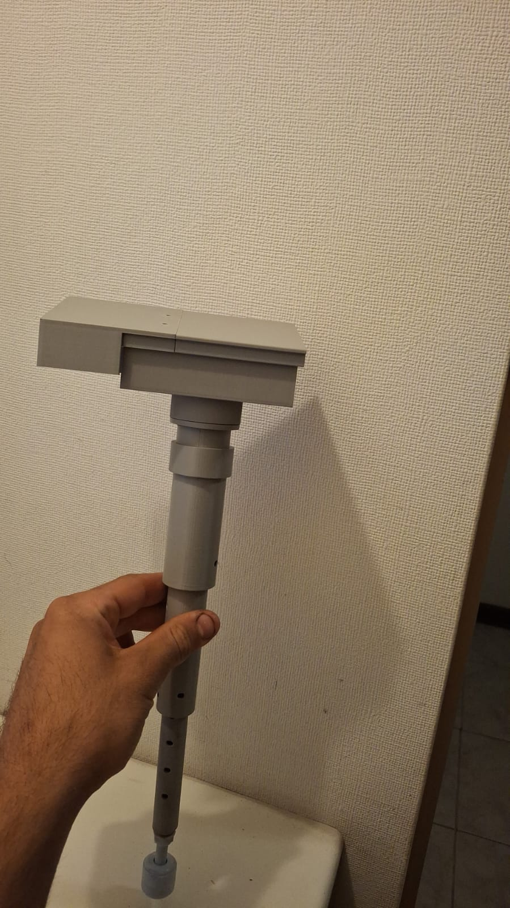

# Diseño 3D del encapsulado

Modelado en **Autodesk Fusion 360**, en el mismo archivo que la PCB (`ESP32_PCB`,
componente `Encapsulado`), así que el gemelo 3D incluye la placa con sus volúmenes reales.

**Responsable:** Diego Poupin.

| Modelo en Fusion 360 | Pieza impresa real |
|---|---|
|  |  |

## Carpetas

| Carpeta | Contenido | Estado |
|---|---|---|
| [`fusion360/`](fusion360/) | `estanque_encapsulado.f3d`: ensamble completo con la PCB y las 7 piezas | ✅ Exportado y verificado (abre) |
| [`stl/`](stl/) | Las 7 piezas listas para imprimir (STL en mm) | ✅ Listo |
| [`renders/`](renders/) | Exterior, exterior en alta resolución, interior y explosionado | ✅ 4 renders |
| [`planos/`](planos/) | 3 láminas con cotas (caja, techo, tubo) y vistas ortogonales | ✅ Listo |

## Piezas

La impresora del equipo imprime como máximo 10 cm por eje, así que el encapsulado se
dividió en 7 piezas con uniones para armarlo después de imprimir.

| # | Pieza | Medidas (mm) | Unión |
|---|---|---|---|
| 01 | [Caja base](stl/01_Caja_Base.stl) | 100,0 × 64,0 × 46,0 | Rosca hembra M36x2 abajo, riel del techo arriba |
| 02 | [Techo A (alero)](stl/02_Techo_A.stl) | 74,0 × 74,0 × 45,6 | Se une al techo B |
| 03 | [Techo B](stl/03_Techo_B.stl) | 89,0 × 74,0 × 29,6 | Lengüeta de 30 mm bajo el techo A, 2 tornillos M3 y adhesivo |
| 04 | [Tubo 1, acople](stl/04_Tubo_1_Acople.stl) | 44,0 × 44,0 × 47,5 | Rosca macho M36x2 a la caja, casquillo de 15 mm abajo |
| 05 | [Tubo 1, tramo](stl/05_Tubo_1_Tramo.stl) | 34,0 × 34,0 × 85,0 | Entra 15 mm en el casquillo (holgura 0,2 mm, epoxi) |
| 06 | [Tubo 2](stl/06_Tubo_2.stl) | 29,0 × 29,0 × 100,0 | Desliza dentro del tubo 1, pasadores de 4 mm |
| 07 | [Tubo 3](stl/07_Tubo_3.stl) | 21,0 × 21,0 × 100,0 | Desliza dentro del tubo 2, rosca hembra M10x1.5 en la punta para el sensor |

Medidas obtenidas de los STL exportados.

## Especificaciones

| Parámetro | Valor |
|---|---|
| Caja (exterior) | 100 × 60 mm de planta, 64 mm contando los rieles |
| Pared / piso | 2,5 mm / 3 mm |
| Holgura placa – pared | 2,5 mm a los lados largos, ≈ 12 mm del lado de las borneras (para doblar cables) y ≈ 1,5 mm del lado del USB (para que el cable alcance) |
| Postes de la placa | 4, de Ø 6 mm y 8 mm de alto, agujero para tornillo M3 |
| Techo | Una sola agua, 15° de pendiente, alero de 45 mm sobre las entradas de cables |
| Riel del techo | Ganchos en L bajo nervios laterales, holgura 0,3 mm, tope del lado de las borneras |
| Entradas de cables | 2 cuadradas de 12 × 12 mm, una frente a cada relé |
| Ventana USB | 13 × 8 mm |
| Tubo telescópico | 3 tramos de 10 cm. Exterior/interior: 34/30, 25,5/21,5 y 17,5/13,5 mm |
| Topes internos | Collarines y rebordes: los tramos no se salen aunque falte el pasador |
| Regulación de altura | Agujeros de 4,2 mm cada 20 mm (5 en el tubo 2, 4 en el tubo 3) |
| Roscas | M36x2 caja–tubo; M10x1.5 tubo–sensor (modeladas, tolerancia 6H/6g) |
| Software / unidades | Fusion 360, mm |
| Fabricación | Impreso por la universidad en filamento gris (ver fotos). Para uso en exterior se recomienda PETG |

## Funcionalidades del encapsulado

- **Protección de la lluvia:** el techo de una sola agua escurre el agua hacia un lado y
  el alero tapa las entradas de cables.
- **Acceso para reparar:** el techo sale deslizándolo, sin herramientas, y deja la placa a la vista.
- **Fijación sin pegamento** de la placa (4 tornillos M3).
- **Entradas separadas** para los cables de cada relé, más la ventana del USB.
- **Tubo telescópico regulable** que lleva el cable del sensor por dentro hasta el estanque.
- **Piezas de 10 cm o menos** para la impresora disponible.

## Cómo imprimir

- Tubos: de pie. El tubo 3 con la punta abajo para que la rosca M10 salga limpia.
- Caja: con la abertura hacia arriba (el refuerzo roscado de abajo necesita soportes).
- Techos: con la cara superior apoyada en la cama.
- Las roscas tienen tolerancia de mecanizado; impresas pueden quedar justas. Conviene
  imprimir una prueba de la M36 o repasar con macho y terraja.
