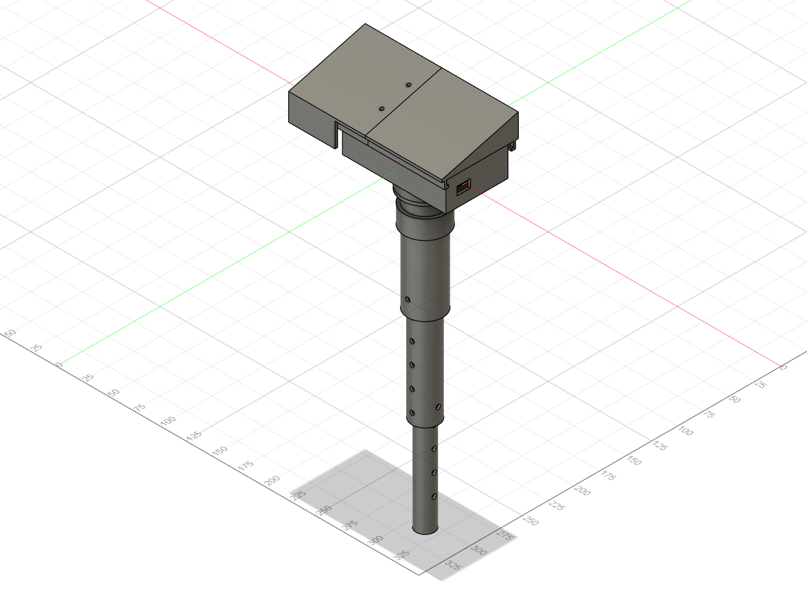
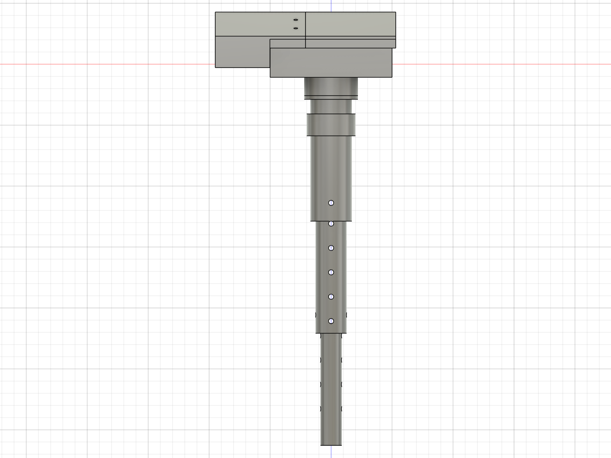

# Planos técnicos

## Vistas ortogonales (exportadas desde Fusion 360, 22-11-2026)

Hoja completa con notas: [`vistas_ortogonales/view_sheet.html`](vistas_ortogonales/view_sheet.html)
(se abre en el navegador; con *Imprimir → Guardar como PDF* queda en PDF).

| Vista | Archivo |
|---|---|
| Isométrica |  |
| Frontal |  |
| Superior |  |
| Lateral derecha |  |

## Cotas principales (mm, tolerancia general ±0,2)

| Elemento | Medida |
|---|---|
| Caja, planta | 100 × 60 (64 con rieles) |
| Caja, altura con techo | ≈ 54 sobre la base, 46 sin techo |
| Pared / piso | 2,5 / 3 |
| Entradas de cables | 2 × (12 × 12) |
| Ventana USB | 13 × 8 |
| Techo | Una sola agua, 15°, alero de 45 |
| Tubo 1 / 2 / 3 (Ø ext./int.) | 34/30 · 25,5/21,5 · 17,5/13,5 |
| Agujeros de pasador | Ø 4,2 cada 20 |
| Roscas | M36x2 (caja–tubo) · M10x1.5 (punta) |

**POR COMPLETAR:** plano con cotas dibujadas sobre las vistas, escala y cajetín (entorno
*Drawing* de Fusion 360), exportado a PDF en esta carpeta.
