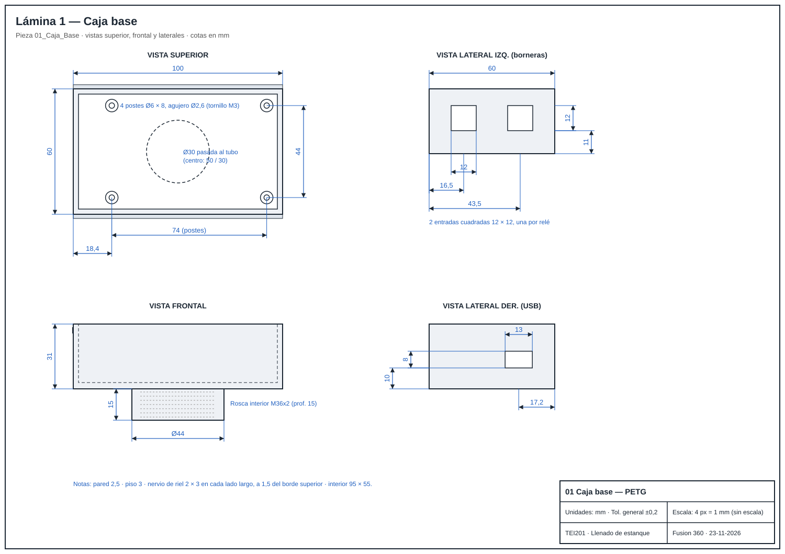
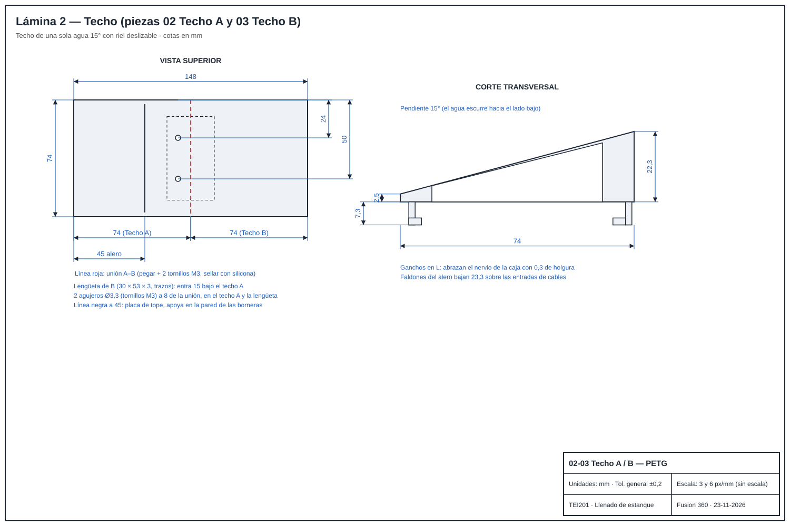
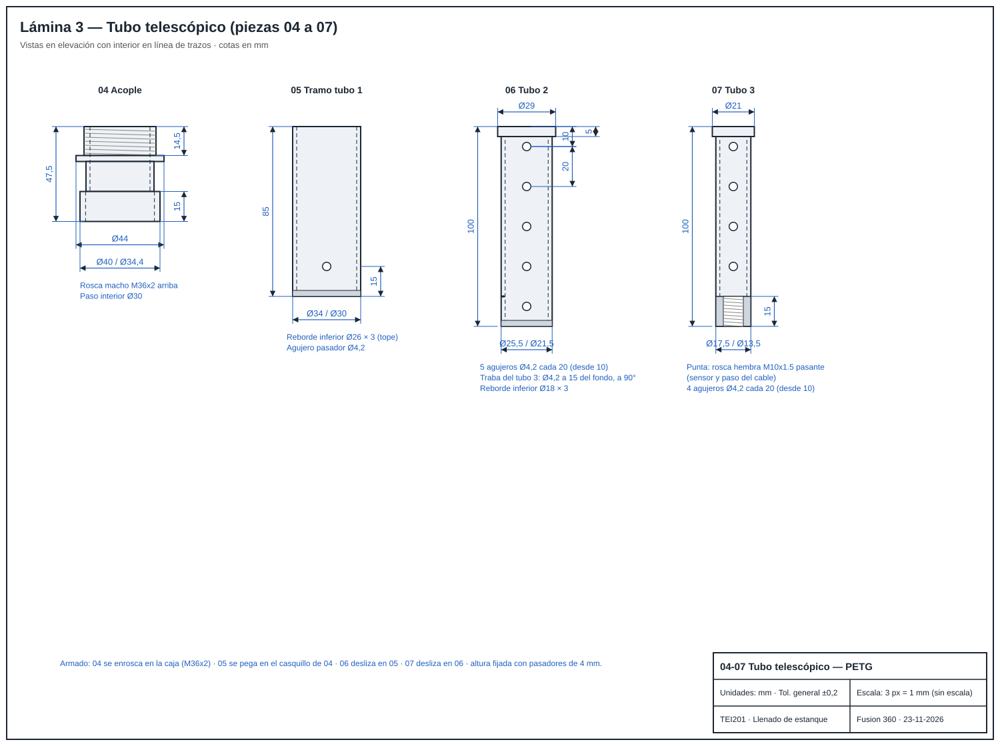
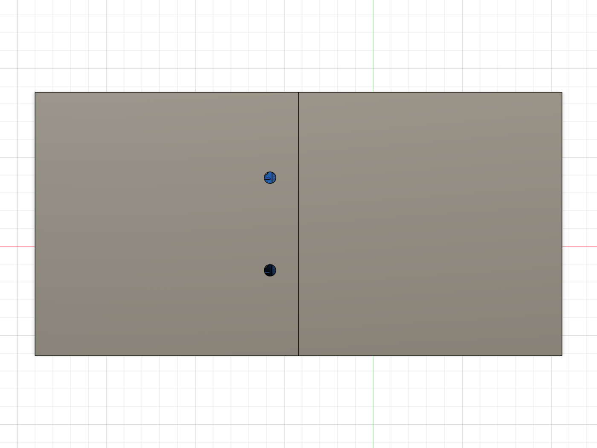
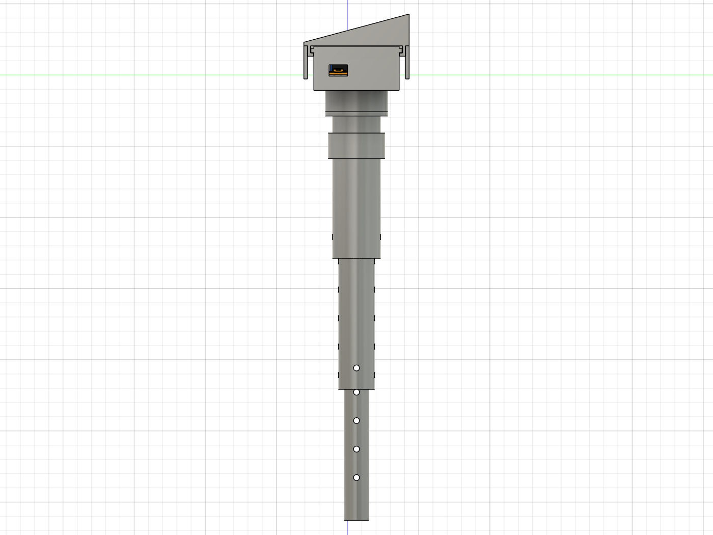

# Planos técnicos

Planos con cotas dibujados con las medidas exactas del modelo de Fusion 360
(23-11-2026). Unidades: mm. Tolerancia general: ±0,2 mm.

| Lámina | Pieza(s) | Vistas |
|---|---|---|
| [`lamina_1_caja_base.svg`](lamina_1_caja_base.svg) | 01 Caja base | Superior, frontal, lateral izquierda (entradas de cables) y lateral derecha (ventana USB) |
| [`lamina_2_techo.svg`](lamina_2_techo.svg) | 02 Techo A y 03 Techo B | Superior (unión, lengüeta, tornillos, alero) y corte transversal (pendiente y ganchos del riel) |
| [`lamina_3_tubo.svg`](lamina_3_tubo.svg) | 04 Acople, 05 Tramo, 06 Tubo 2, 07 Tubo 3 | Elevación de cada pieza con diámetros, largos, roscas y agujeros de pasador |

## Vistas ortogonales del ensamble (exportadas desde Fusion 360)

Hoja completa: [`vistas_ortogonales/view_sheet.html`](vistas_ortogonales/view_sheet.html)
(se abre en el navegador; con *Imprimir → Guardar como PDF* queda en PDF).

| Isométrica | Frontal | Superior | Lateral |
|---|---|---|---|
|  |  |  |  |

Para imprimir las láminas: abrir el `.svg` en el navegador → Imprimir → Guardar como PDF.
