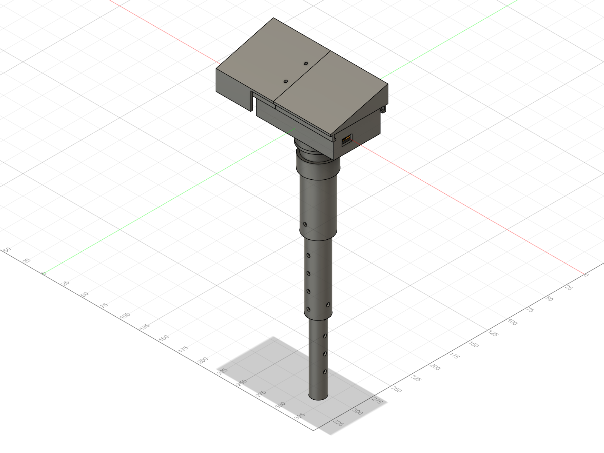
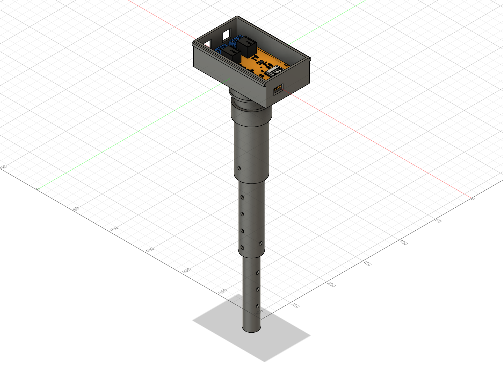
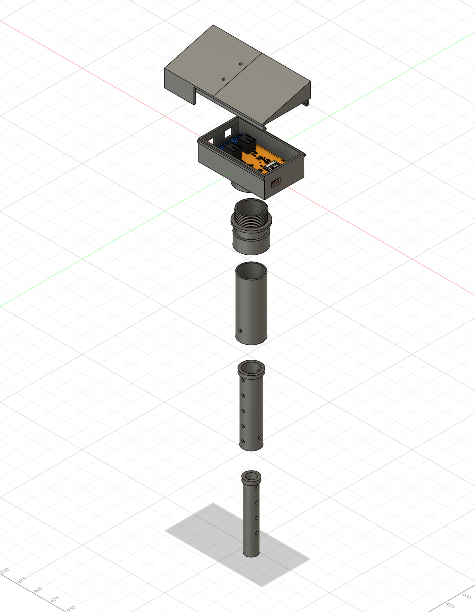

# Renders

| Archivo | Vista | Estado |
|---|---|---|
| [`render_01_iso_v3_final.png`](render_01_iso_v3_final.png) | Exterior isométrica con la caja semitransparente (se ve la placa dentro) | ✅ |
| [`render_02_exterior_alta.png`](render_02_exterior_alta.png) | Exterior en alta resolución (1600 × 1200), techo puesto y tubo extendido | ✅ |
| [`render_03_interior.png`](render_03_interior.png) | Interior con el techo quitado: placa, relés, borneras, entradas cuadradas y ventana USB | ✅ |
| [`render_04_explosionado.png`](render_04_explosionado.png) | Explosionado: techo (A + B), caja con la placa, acople roscado M36x2, tramo del tubo 1, tubo 2 y tubo 3 | ✅ |

Las versiones anteriores del diseño están en [`../../iteraciones/`](../../iteraciones/).
