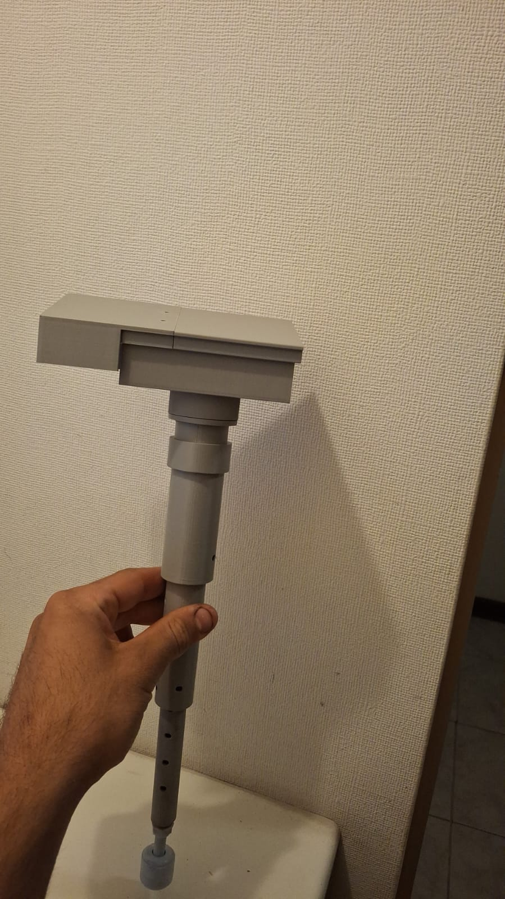
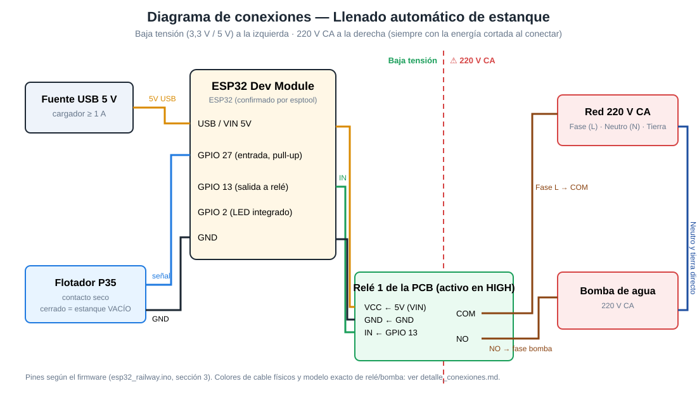

# Hardware

## Carpetas

| Carpeta | Contenido |
|---|---|
| [`esquemas/`](esquemas/) | Diagrama de conexiones, tabla de cables y modelo de la PCB |
| [`bom/`](bom/) | Lista de materiales con precios y enlaces |
| [`fotos/`](fotos/) | Fotos reales del prototipo |

| Prototipo impreso | Diagrama de conexiones |
|---|---|
|  |  |

**Integrantes a cargo:** Mateo Candela (electrónica y testing) y Claudio Martínez (firmware).

## Componentes principales y por qué se eligieron

| Componente | Función | Justificación técnica |
|---|---|---|
| **ESP32 Dev Module** | Leer el flotador, controlar el relé, publicar la página local y enviar datos a Railway | Tiene WiFi integrado (2,4 GHz) para enviar por HTTPS, dos núcleos (uno controla la bomba y el otro envía a la nube) y pines de 3,3 V con pull-up interna. Se programa con Arduino IDE, como pide la guía del curso |
| **Flotador P35** | Detectar si el estanque está lleno o vacío | Es un contacto seco: no necesita alimentación ni calibración y no se ve afectado por la turbidez o la espuma, que sí afectan a un sensor ultrasónico. Basta con una entrada digital y GND. Como no mide litros, la decisión es todo o nada |
| **Relé 5 V (activo en HIGH)**: SRA-05VDC-CL en la PCB ([datasheet](https://datasheet.lcsc.com/szlcsc/Ningbo-Songle-Relay-SRA-05VDC-CL_C99666.pdf)) | Encender y apagar la bomba de 220 V | Separa galvánicamente los 220 V de la lógica de 3,3 V. Es SPDT (COM, NO, NC). La bobina es de 5 V y 42 Ω, o sea unos 120 mA: más de lo que entrega un pin del ESP32 (unos 40 mA como máximo). Por eso la PCB lo activa con un transistor (Q4/Q5, SOT-23) y un diodo de protección. El equipo verificó que los contactos del relé soportan los 220 V de la bomba |
| **Bomba de agua 220 V** | Llenar el estanque de 2000 L | Bomba económica ($6.000 CLP) que funciona directo con la red de 220 V, así que el relé solo tiene que cortar la fase |
| **Cargador USB 5 V** | Alimentar todo el circuito de baja tensión | Un cargador común de celular de 1 A o más alcanza para el ESP32 con WiFi y la bobina del relé |
| **Encapsulado impreso en 3D** | Proteger la electrónica de la lluvia y llevar el flotador al estanque | Ver [`../diseno_3d/`](../diseno_3d/) |

### Pines usados

| Pin ESP32 | Conexión | Modo |
|---|---|---|
| GPIO 27 | Flotador P35 | Entrada con pull-up interna. Contacto cerrado (LOW) = VACÍO |
| GPIO 13 | Relé IN | Salida. HIGH = bomba encendida |
| GPIO 2 | LED integrado | Salida. Encendido = bomba funcionando |
| VIN 5 V / GND | Relé VCC / GND y flotador GND | Alimentación |

Detalle con colores de cable: [`esquemas/detalle_conexiones.md`](esquemas/detalle_conexiones.md).

## Ensamble

### Eléctrico (con la energía de 220 V cortada)

1. Conectar el flotador entre **GPIO 27** y **GND**.
2. Conectar el relé: **VCC → VIN (5 V)**, **GND → GND**, **IN → GPIO 13**.
3. Cortar la energía de 220 V. Conectar **fase (L) → COM** del relé y **NO → fase de la bomba**.
   Neutro y tierra van directo a la bomba.
4. Alimentar el ESP32 con el cargador USB de 5 V.
5. Comprobar en el Monitor Serie (115200) que el nivel cambia al mover el flotador.

### Mecánico

1. Imprimir las 7 piezas del encapsulado (ver [`../diseno_3d/`](../diseno_3d/)).
2. Fijar la placa a los 4 postes de la caja con tornillos **M3**.
3. Pasar los cables de cada relé por su entrada cuadrada de 12 × 12 mm, idealmente con pasacables.
4. Enroscar el tubo a la base de la caja (rosca M36x2) y pasar el cable del flotador por dentro del tubo.
5. Deslizar el techo por el riel desde el lado del USB hasta el tope.

## Precauciones

- **Nunca** manipular la parte de 220 V con la energía conectada.
- Mantener la zona de 220 V (relé y bomba) **separada** de la lógica de 3,3 V.
- La electrónica va dentro de la caja con techo. Solo el flotador entra en contacto con el agua.
- Al encender, el firmware parte en DESCANSO (60 s) para que la bomba no arranque de golpe tras un corte de luz.
- Se recomienda conectar la bomba a un circuito con protección eléctrica (disyuntor o fusible).

## Especificaciones técnicas

| Parámetro | Valor |
|---|---|
| Alimentación de la lógica | 5 V por USB (ESP32 a 3,3 V internos) |
| Lógica del flotador | Contacto cerrado = VACÍO (configurable en el código) |
| Lógica del relé | Activo en HIGH (configurable) |
| Retardo de arranque | 10 s |
| Retardo de corte | 0 s |
| Descanso mínimo del motor | 60 s |
| Antirrebote | 80 ms |
| WiFi | 2,4 GHz, varias redes guardadas |
| Envío a la nube | Al cambiar y cada 60 s |

## Diseño para la reparación

- La placa va **atornillada** con 4 tornillos M3, sin pegamento, así que se puede sacar entera.
- El techo **desliza por un riel**: se saca sin herramientas y deja la placa a la vista.
- Los cables de potencia van a **borneras** (T1, T2 en la PCB): se cambian sin soldar.
- El tubo se **desenrosca** de la caja (M36x2) y sus tramos se separan quitando los pasadores.
- El sensor se **enrosca** en la punta del tubo (M10x1.5).
- Las redes WiFi, los pines y los tiempos se cambian en un solo lugar del código (secciones 1 a 3).
- Código de colores: **morado y verde** para el flotador P35 (baja tensión) y **amarillo**
  para la bomba (220 V). Así se distingue a simple vista qué cable lleva tensión de red.
