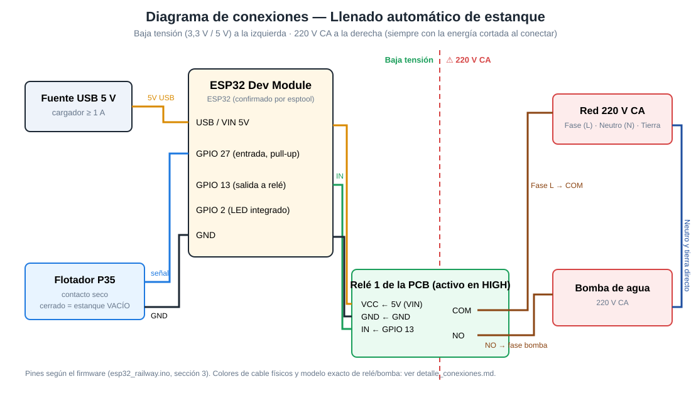
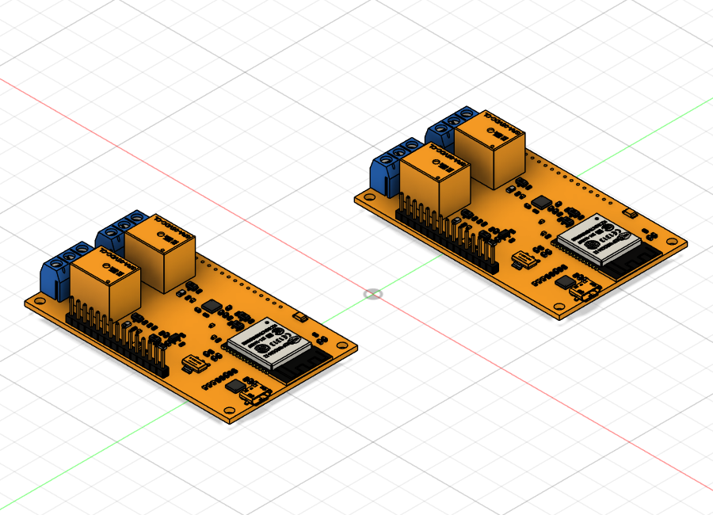

# Detalle de conexiones

Pines tomados del firmware (`esp32_railway.ino`, sección 3). Colores informados por el
equipo: **morado y verde** para el flotador P35 y **amarillo** para la bomba.

## Baja tensión

| Origen | Destino | Cable / conexión | Función |
|---|---|---|---|
| Fuente USB 5 V | ESP32 (conector USB) | Cable micro USB | Alimentación |
| Flotador P35, cable 1 | ESP32 GPIO 27 | Morado o verde* | Señal de nivel (entrada con pull-up interna) |
| Flotador P35, cable 2 | ESP32 GND | Verde o morado* | Referencia |
| ESP32 VIN (5 V) | Relé VCC | Pista de la PCB | Alimentación de la bobina del relé |
| ESP32 GND | Relé GND | Pista de la PCB | Referencia |
| ESP32 GPIO 13 | Relé IN (vía transistor) | Pista de la PCB | Orden de encendido (activo en HIGH) |
| ESP32 GPIO 2 | LED integrado | Pista de la PCB | Encendido = bomba funcionando |

\* El flotador P35 es un contacto seco sin polaridad: da lo mismo cuál de los dos cables va
a GPIO 27 y cuál a GND.

## 220 V CA (siempre con la energía cortada al conectar)

| Origen | Destino | Cable / conexión | Función |
|---|---|---|---|
| Red, fase (L) | Relé COM (bornera de la PCB) | Cable de alimentación de la bomba | Fase que interrumpe el relé |
| Relé NO (bornera de la PCB) | Bomba, fase | Amarillo | Fase hacia la bomba solo cuando el relé está activo |
| Red, neutro (N) | Bomba, neutro | Cable de alimentación de la bomba | Directo |
| Red, tierra | Bomba, tierra | Cable de alimentación de la bomba | Protección |

## Por qué esos pines

| Pin | Motivo |
|---|---|
| GPIO 27 (flotador) | Pin de entrada normal, con pull-up interna, que no interviene en el arranque del ESP32 |
| GPIO 13 (relé) | Es el pin conectado al Relé 1 en la PCB de la universidad (el Relé 2 está en GPIO 15) |
| GPIO 2 (LED) | LED integrado de la placa, sirve como indicador sin agregar piezas |

## PCB

La placa la proporcionó la universidad. El diseño de Fusion 360 `ESP32_PCB` contiene la
PCB con dos relés SRA-05VDC-CL, dos borneras de 3 polos (T1, T2), conector micro USB,
regulador SOT-223, transistores SOT-23 (Q4, Q5) que activan los relés, diodos, LED y un
sensor de luz TEMT6000 (no usado en este proyecto).

