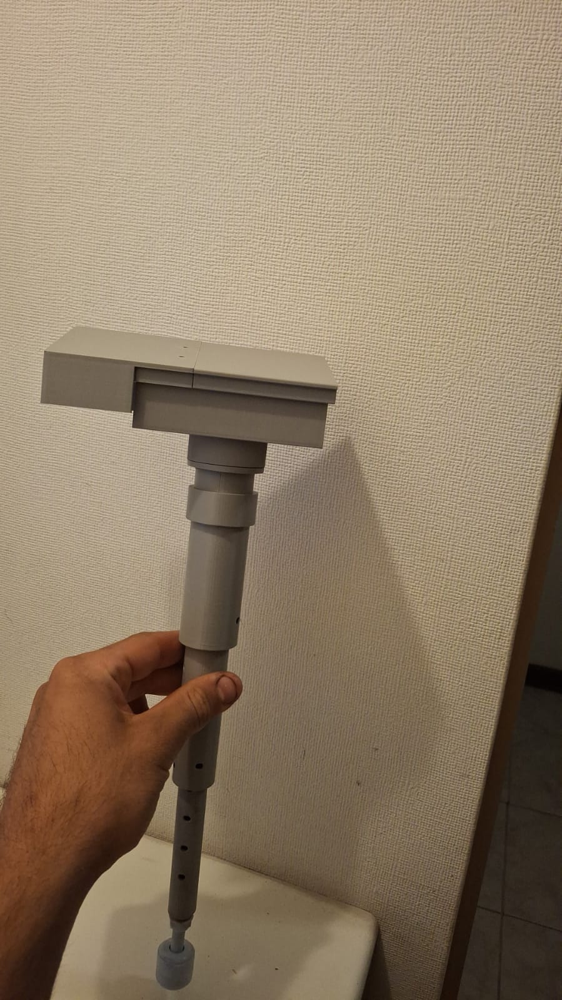
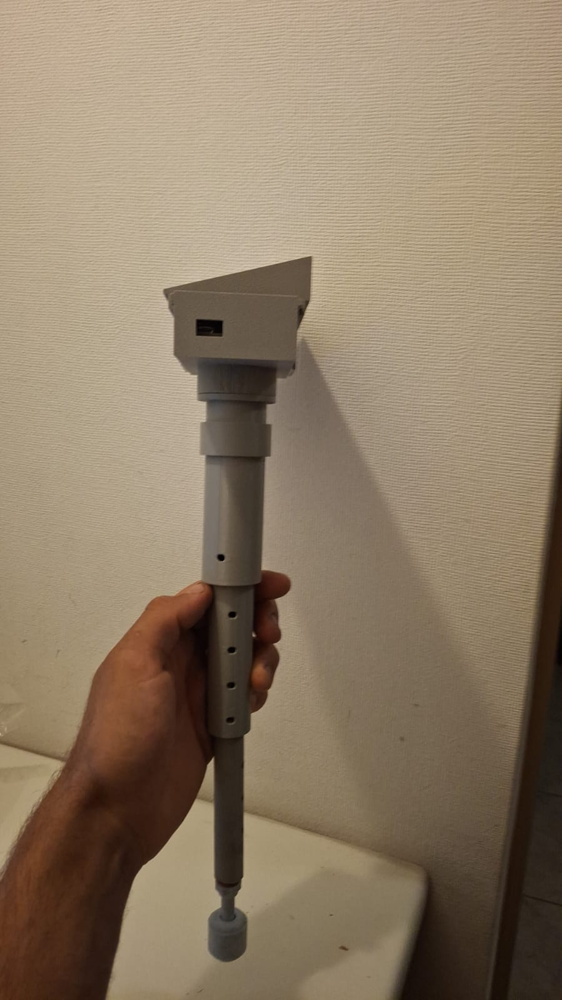

# Fotos del prototipo

## Encapsulado impreso (provisto por la universidad)

| Archivo | Qué muestra |
|---|---|
| [`foto_01_encapsulado_frontal.jpg`](foto_01_encapsulado_frontal.jpg) | Encapsulado armado, de frente. Se ven el techo de una sola agua con la unión de los techos A y B (con sus 2 agujeros para tornillos), el alero sobre las entradas de cables, el refuerzo roscado bajo la caja, el tubo telescópico extendido con los agujeros de los pasadores y el flotador P35 enroscado en la punta |
| [`foto_02_encapsulado_lateral_usb.jpg`](foto_02_encapsulado_lateral_usb.jpg) | Vista lateral: ventana del USB, pendiente del techo, acople roscado M36x2 y los tres tramos del tubo |

| Frontal | Lateral |
|---|---|
|  |  |

Las fotos confirman que las 7 piezas impresas encajan como en el modelo de Fusion 360:
el techo sobre el riel, la rosca M36x2 entre la caja y el tubo, el casquillo del tubo 1
y los tramos telescópicos.

El interior de la caja (placa, relés, borneras y entradas de cables) se puede ver en el
[render interior](../../diseno_3d/renders/render_03_interior.png) del modelo 3D.
