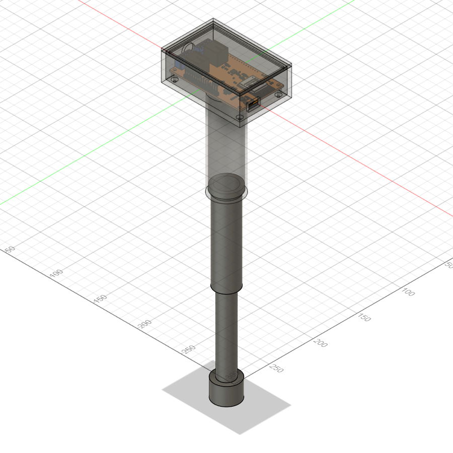

# Iteración 1 — Control local y primer encapsulado

**Fecha:** hasta el 16-11-2026

```
Flotador P35 ──> ESP32 ──> Relé ──> Bomba 220 V
                   │
                   └── Monitor Serie (solo por cable USB)
```

## Qué se hizo

- **Firmware:** control de la bomba con el flotador P35 y un relé, con una máquina de
  estados de 5 estados, retardo de arranque, retardo de corte, descanso mínimo del motor
  y antirrebote. La información solo se veía por el Monitor Serie.
- **Diseño 3D (16-11-2026):** primera caja con tapa a presión, que envuelve la placa
  con 2 mm de holgura, más un tubo telescópico de 3 tramos de 10 cm con rosca M20x1.5
  para el sensor.



## Qué se midió

- Caja de 89 × 59 × 34 mm aprox. y tubo de 31 cm extendido (medidas del modelo).

## Qué falló o faltaba

- No había forma de ver el estado sin un computador conectado.
- La tapa plana no protegía de la lluvia y había que quitarla para trabajar.
- Una sola entrada de cables para los dos relés.
- La rosca del sensor (M20x1.5) no era la del sensor real.

## Qué se decidió

- Agregar una página web en el ESP32.
- Rediseñar la caja con techo para la lluvia y entradas separadas.
