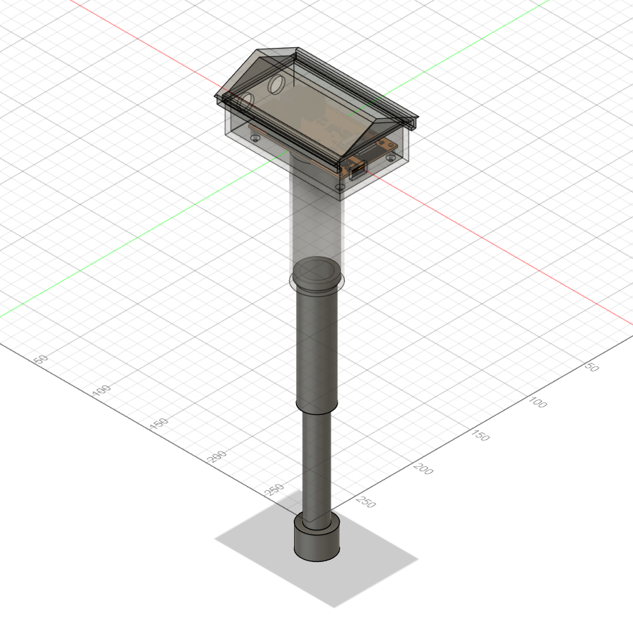
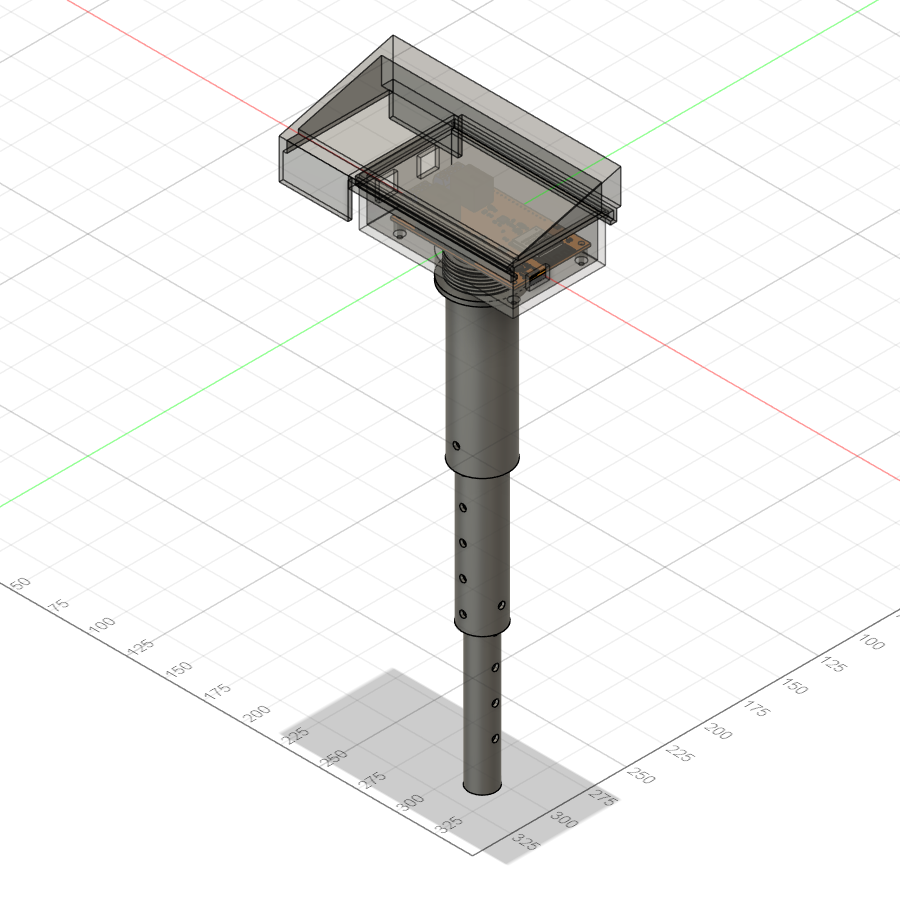

# Iteración 2 — Página web local y encapsulado para exterior

**Fecha:** 16-11-2026

```
Flotador P35 ──> ESP32 ──> Relé ──> Bomba 220 V
                   │
                   └── WiFi ──> página local http://IP-de-la-placa (mismo WiFi)
```

## Qué se hizo

- **Firmware:** el ESP32 publica una página web propia, con nivel, bomba, estado,
  tiempos, llenados y últimos eventos, que se actualiza cada 2 s.
- **Diseño 3D, versión 2:** base de 100 × 60 mm y techo a dos aguas que desliza por un riel.



- **Diseño 3D, versión 3 (mismo día):** techo de **una sola agua** con alero de 45 mm
  sobre las entradas, entradas **cuadradas** por relé, unión **roscada M36x2** entre tubo
  y caja, **agujeros para pasadores** que hacen regulable el tubo y rosca **M10x1.5**
  para el sensor. Se dividió en **7 piezas de 10 cm o menos** para la impresora.



## Qué se midió

- La página local funcionaba desde un celular en el mismo WiFi.
- Ninguna pieza del encapsulado supera 100 mm. La prueba de interferencias de Fusion no
  encontró choques entre las piezas y la placa.

## Qué falló o faltaba

- La página solo se veía **dentro del mismo WiFi**: no servía para revisar el estanque a distancia.
- No quedaba historial: los datos se perdían al reiniciar.
- No cumplía la arquitectura pedida por la guía del curso (ESP32 → Railway → Aiven).

## Qué se decidió

- Enviar los datos a un servidor en la nube y guardarlos en una base de datos.
