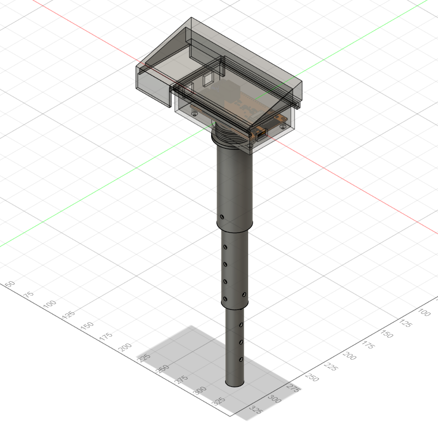

# Iteración 3 — Nube (Railway + Aiven) y versión final

**Fecha:** 21 y 22-11-2026 (commits `3b64aa6` y `4f7162b`)

```
ESP32 (flotador P35 + relé) --POST HTTPS--> Railway (Express + página) --SQL con SSL--> Aiven (PostgreSQL)
        │                                            ▲
        └── página local (mismo WiFi)                └── celular o PC desde cualquier lugar
```



## Qué se hizo

- **Servidor Express en Railway** con `POST /api/lecturas` protegido con `x-api-key`,
  `GET /api/lecturas` y `/api/salud`.
- **Base PostgreSQL en Aiven** (plan Free), tabla `lecturas`.
- **Dashboard público:** estado, gráfico, historial y alerta SIN SEÑAL.
- **Firmware:**
  - El envío corre en una tarea aparte (núcleo 0) con cola y reintentos.
  - WiFi no bloqueante y lista de varias redes (WiFiMulti).
  - Se mantiene la página local.
- **Claves fuera del repositorio:** WiFi, API_KEY y contraseña de Aiven.

## Qué se midió

- Prueba de puesta en marcha (22-11-2026): 34 lecturas guardadas, respuestas `201`,
  retardo de arranque de 10 s y descanso de 60 s verificados, alerta SIN SEÑAL al desconectar.
  Ver [`../../testing/`](../../testing/).

## Qué falló y qué se cambió

| Problema | Cambio |
|---|---|
| El código esperaba al WiFi y podía frenar el control | Envío en otra tarea y WiFi no bloqueante |
| Había que cambiar el código para cada WiFi | Lista de redes (WiFiMulti) |
| Errores al configurar Aiven en Railway (`CLICK_TO`, `ENOTFOUND`) | Se documentó cómo armar la URI correctamente |
| Placa equivocada en el IDE (ESP32-C3 / S2) | Se documentó elegir **ESP32 Dev Module** |
| Riesgo de subir la clave del WiFi a GitHub | El `.ino` publicado usa valores de ejemplo y se revisó el historial |

## Pendiente

- Pruebas formales del protocolo (A, B, C y D con 5 usuarios).
- Indicadores de uso diario con datos de varios días.
