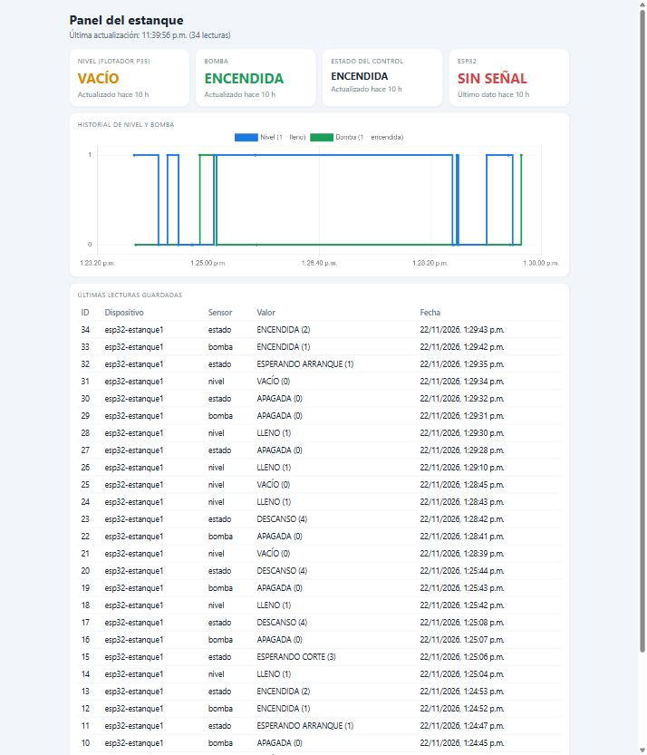

# Software

El software tiene tres partes que trabajan juntas:

```
ESP32 (flotador P35 + relé) --POST HTTPS--> Railway (Express + página) --SQL con SSL--> Aiven (PostgreSQL)
        │                                            ▲
        └── página local http://IP-de-la-placa       └── navegador (celular o PC, desde cualquier lugar)
```

**Página publicada:** https://esp32-railway-estanque-production.up.railway.app



## Dónde está el código

Para no romper el deploy de Railway, que lee `server.js` y `package.json` desde la raíz,
el código **no se movió**. Esta carpeta solo agrega la documentación.

| Archivo | Qué hace |
|---|---|
| [`../server.js`](../server.js) | Servidor Express: recibe lecturas del ESP32, las guarda en PostgreSQL y entrega la página |
| [`../package.json`](../package.json) | Dependencias de Node (express, pg, dotenv) y comando `npm start` |
| [`../.env.example`](../.env.example) | Plantilla de las variables `DATABASE_URL`, `DB_CA_CERT` y `API_KEY`, sin claves reales |
| [`../public/index.html`](../public/index.html) | Dashboard: estado actual, alerta "sin señal", gráfico e historial |
| [`../esp32/esp32_railway/esp32_railway.ino`](../esp32/esp32_railway/esp32_railway.ino) | Firmware del ESP32: control de la bomba, página local y envío a la nube |
| [`docs/captura_y_datos.md`](docs/captura_y_datos.md) | Qué se mide, cómo se guarda y qué información entrega |
| [`docs/api.md`](docs/api.md) | Documentación de la API |
| [`librerias/README.md`](librerias/README.md) | Librerías con versión exacta |

## Cómo ponerlo en marcha

1. **Requisitos:** Node.js LTS (18 o más), Git y Arduino IDE 2 con el paquete ESP32
   (3.3.12) y la librería **ArduinoJson** (7.4.3).
2. **Aiven:** crear un servicio PostgreSQL con plan **Free** y copiar la *Service URI*
   y el *CA certificate*.
3. **Probar en el computador:** copiar `.env.example` a `.env`, poner los datos reales y
   ejecutar `npm install` y `npm start`. `http://localhost:3000/api/salud` debe responder
   `{"ok":true,"db":"conectada"}`.
4. **Railway:** nuevo proyecto desde este repositorio, variables `DATABASE_URL`,
   `DB_CA_CERT` y `API_KEY`, botón **Deploy** y **Generate Domain** en Settings → Networking.
5. **ESP32:** en la sección 1 de `esp32_railway.ino`, escribir las redes WiFi
   (2,4 GHz), la URL de Railway terminada en `/api/lecturas` y la misma `API_KEY`.
   Subir con la placa **ESP32 Dev Module**. En el Monitor Serie (115200) debe aparecer `-> 201`.

## Calidad del código

| Decisión | Por qué |
|---|---|
| **Máquina de estados** con 5 estados (APAGADA, ESPERANDO ARRANQUE, ENCENDIDA, ESPERANDO CORTE, DESCANSO) | Evita que la bomba prenda y apague muchas veces cuando el agua se mueve y el flotador oscila |
| **Retardo de arranque (10 s)** y **descanso mínimo (60 s)** | Protegen el motor de la bomba. Tras un corte de luz, el equipo parte en DESCANSO para no arrancar de golpe |
| **Antirrebote de 80 ms** en la entrada del flotador | Filtra rebotes eléctricos del contacto |
| **Relé en APAGADO antes de configurar el pin** | Evita un pulso que encienda la bomba al energizar el ESP32 |
| **Envío a la nube en otra tarea (núcleo 0)** con una cola de 30 lecturas | El control de la bomba (núcleo 1) nunca espera al WiFi ni al servidor |
| **Reintentos** (hasta 3) y descarte de errores de configuración (400, 401, 404) | Si el servidor falla un momento no se pierde el dato; si la configuración está mal, no se insiste en vano |
| **WiFiMulti** con lista de redes | La placa funciona en distintos lugares sin cambiar el código cada vez |
| **WiFi no bloqueante** | La bomba funciona aunque no haya internet |
| **Consultas SQL parametrizadas** (`$1`, `$2`, `$3`) | Evitan inyección SQL |
| **Validación en el servidor** (campos obligatorios, `valor` numérico y finito, largo máximo 50) | Rechaza datos malos con 400 antes de tocar la base |
| **`x-api-key`** en `POST /api/lecturas` | Solo el ESP32 del equipo puede escribir en la base (responde 401 sin la clave) |
| **Sin claves en el repositorio** | `.env` está en `.gitignore`; el `.ino` publicado tiene valores de ejemplo. Se revisó todo el historial de Git |
| **Escape de HTML** en la tabla del dashboard | Un texto guardado en la base no se interpreta como código |

## Diferencias con el código de ejemplo de la guía

- El envío corre en una tarea aparte con cola y reintentos; en la guía el `loop()` espera al envío.
- El WiFi no bloquea: en la guía `conectarWiFi()` se queda esperando.
- Se guardan varias redes WiFi (WiFiMulti).
- El ESP32 tiene además una página local (`http://IP-de-la-placa` o `http://estanque.local`).
- `POST /api/lecturas` rechaza valores no finitos y `GET /api/lecturas` acepta `?sensor=`.
- El dashboard muestra el estado del estanque y avisa **SIN SEÑAL** si no llegan datos hace más de 3 minutos.

## Seguridad

- `.env` nunca se sube a GitHub. Si se sube por error, cambiar la contraseña de Aiven y la `API_KEY`.
- No pegar en un chat la `DATABASE_URL`, la contraseña de Aiven, la `API_KEY` ni la clave del WiFi.
- `cliente.setInsecure()` cifra la conexión pero no verifica el certificado del servidor
  (aceptable para el curso, como dice la guía).
