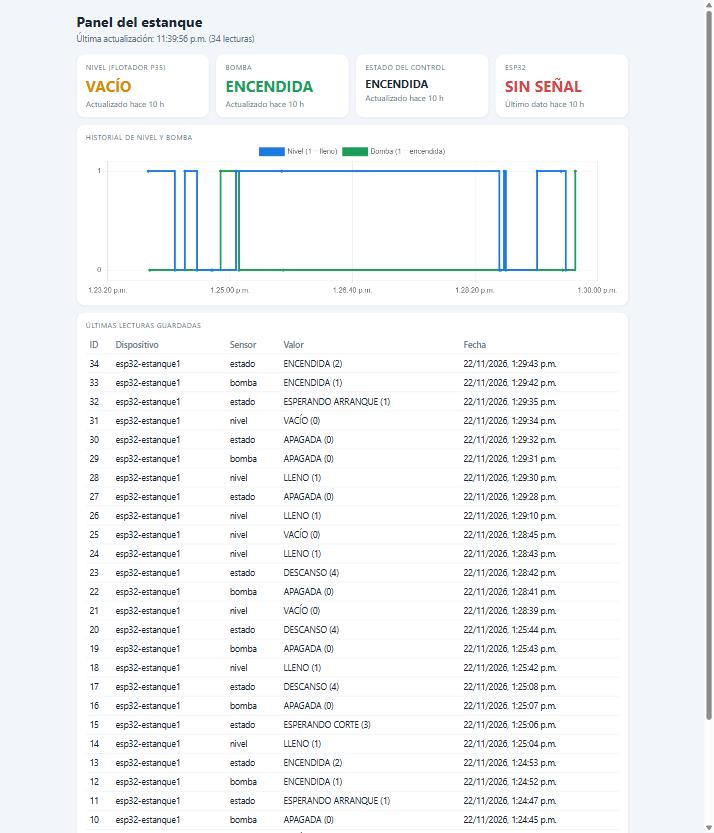
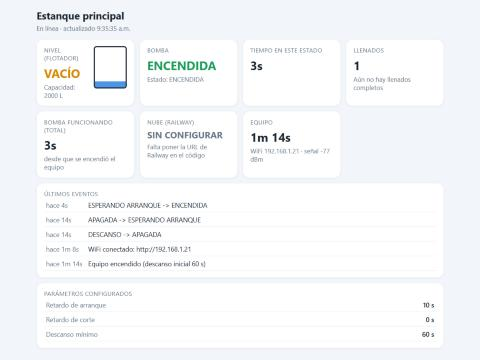

# Captura de datos, repositorio de datos y generación de información

## 1. Captura de datos

### Qué se mide

| Dato (`sensor`) | Valores | Origen |
|---|---|---|
| `nivel` | 1 = estanque LLENO, 0 = VACÍO | Flotador P35 conectado a GPIO 27 (con pull-up interna; contacto cerrado = VACÍO) |
| `bomba` | 1 = ENCENDIDA, 0 = APAGADA | Salida que el ESP32 manda al relé (GPIO 13) |
| `estado` | 0 APAGADA, 1 ESPERANDO ARRANQUE, 2 ENCENDIDA, 3 ESPERANDO CORTE, 4 DESCANSO | Máquina de estados del firmware |

El flotador es un sensor **de contacto (todo o nada)**: no mide litros, indica si el agua
llegó o no al punto donde está instalado. Por eso `nivel` vale 0 o 1.

### Cada cuánto se envía y por qué

- **Al cambiar:** cada vez que cambia `nivel`, `bomba` o `estado`, el dato se envía de
  inmediato. Así el historial registra el momento exacto de cada llenado.
- **Cada 60 s:** se mandan los tres datos aunque no cambien. Funciona como **latido**:
  si la página no recibe nada en 3 minutos, muestra **SIN SEÑAL**.
- **Por qué no más seguido:** el nivel de un estanque de 2000 L cambia en minutos, no en
  segundos. Enviar cada segundo llenaría la base de datos gratuita (1 GB) sin aportar información.

### Filtros antes de enviar

1. **Antirrebote de 80 ms** en el flotador.
2. **Retardo de arranque de 10 s:** el flotador tiene que marcar VACÍO durante 10 s
   seguidos antes de encender la bomba. Si el agua se mueve y vuelve a LLENO, se cancela.
3. **Descanso de 60 s:** después de cortar, la bomba no puede volver a encenderse hasta pasado un minuto.

### Si no hay internet

- El control de la bomba sigue funcionando: depende solo del flotador.
- Las lecturas quedan en una **cola de 30 posiciones**. Una tarea aparte, en el núcleo 0,
  las envía cuando vuelve el WiFi.
- Si un envío falla, se reintenta **hasta 3 veces** con 3 s de espera entre intentos.
- Errores de configuración (400, 401, 404) no se reintentan: se avisa por el Monitor Serie.

## 2. Repositorio de datos

Base **PostgreSQL 18 en Aiven** (plan Free), tabla `lecturas`:

| Columna | Tipo | Descripción |
|---|---|---|
| `id` | SERIAL, clave primaria | Número correlativo |
| `dispositivo` | VARCHAR(50) | Quién envía (`esp32-estanque1`) |
| `sensor` | VARCHAR(50) | `nivel`, `bomba` o `estado` |
| `valor` | REAL | Valor numérico |
| `creado_en` | TIMESTAMPTZ | Hora en que el servidor recibió el dato (UTC) |

**Por qué una sola tabla con formato `sensor / valor`:** se pueden agregar sensores
nuevos (por ejemplo el de luz TEMT6000 de la PCB) sin cambiar la base de datos. Es el
formato propuesto por la guía del curso.

**Cómo se consulta:** `GET /api/lecturas?limite=300` para todo, o `?sensor=nivel` para
un solo dato (ver [`api.md`](api.md)). Desde la consola de Aiven se puede usar el SQL editor:

```sql
SELECT sensor, COUNT(*) FROM lecturas GROUP BY sensor;
SELECT * FROM lecturas WHERE sensor = 'bomba' ORDER BY id;
```

**Validación:** el servidor rechaza con 400 los datos sin `dispositivo` o `sensor`, o con
un `valor` que no sea un número finito. Solo acepta escrituras con la `x-api-key` correcta.

**Respaldo de los datos reales:** [`../../testing/datos/`](../../testing/datos/) tiene
la exportación del 22-11-2026 (34 lecturas) en JSON y CSV.

**Ojo con la hora:** `creado_en` es la hora de **llegada al servidor**. Cada envío
HTTPS tarda alrededor de 1,2 s y la cola se envía de a uno, así que puede haber
1 a 4 s de diferencia con el momento real del cambio.

## 3. Generación de información

### Lo que muestra hoy el dashboard



| Indicador | Decisión que permite |
|---|---|
| Nivel actual (LLENO/VACÍO) | Saber a distancia si hay agua |
| Bomba ENCENDIDA/APAGADA | Confirmar que la bomba responde cuando el estanque se vacía |
| Estado del control | Entender qué está haciendo el sistema (por ejemplo, "DESCANSO" significa que espera para proteger el motor) |
| **SIN SEÑAL** si no llegan datos en 3 min | Detectar un corte de luz, de WiFi o una placa desconectada. En la captura se ve esta alerta: la placa se desconectó después de las pruebas |
| Gráfico escalonado de nivel y bomba | Ver cuándo se vació el estanque y cuánto tardó en llenarse |
| Tabla de lecturas | Revisar el historial exacto |

La **página local del ESP32** (`http://IP-de-la-placa`) muestra además: cantidad de
llenados, duración del último llenado, tiempo total de bomba encendida y los últimos
15 eventos.



### Indicadores calculados con los datos reales (22-11-2026, prueba de puesta en marcha)

A partir de [`lecturas_2026-11-22.csv`](../../testing/datos/lecturas_2026-11-22.csv):

| Indicador | Valor | Cálculo |
|---|---|---|
| Lecturas recibidas | 34 (13 nivel, 8 bomba, 13 estado) | Conteo por sensor |
| Encendidos de la bomba | 2 | Transiciones `bomba` 0 → 1 (ids 12 y 33) |
| Duración del ciclo completo registrado | ≈ 15 s | `bomba` = 1 a las 16:24:52, `bomba` = 0 a las 16:25:07 (UTC) |
| Tiempo de confirmación antes de encender | ≈ 10 s | `estado` 1 (16:24:43) → 2 (16:24:53), igual al retardo programado |

Estos valores salen de una **prueba manual** en la que se movió el flotador con la mano,
no de un llenado real del estanque. Los indicadores de uso diario (encendidos por día,
minutos de bomba encendida por día, tiempo con el estanque vacío) se obtienen con las mismas
consultas cuando el equipo funciona varios días seguidos.
