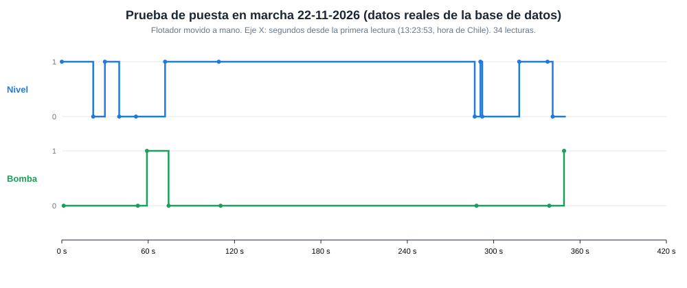

# Testing

**Responsable:** Mateo Candela.

| Carpeta | Contenido |
|---|---|
| [`reportes/protocolo_pruebas.md`](reportes/protocolo_pruebas.md) | Protocolo de las pruebas A (funcional), B (conectividad) y C (tiempos) |
| [`reportes/reporte_testing.md`](reportes/reporte_testing.md) | Resultados de la puesta en marcha, modos de falla y validación contra el problema |
| [`datos/`](datos/) | Datos crudos exportados de la base de datos (JSON y CSV) |
| [`evidencias/`](evidencias/) | Gráfico de la prueba con datos reales |

## Resumen de resultados

| Prueba | Resultado |
|---|---|
| Puesta en marcha (22-11-2026) | 34 lecturas guardadas, 2 encendidos de la bomba, retardo de 10 s y descanso de 60 s verificados, alerta SIN SEÑAL verificada |
| A. Funcional, B. Conectividad y C. Tiempos | Protocolo definido para validar el sistema en un estanque real |

