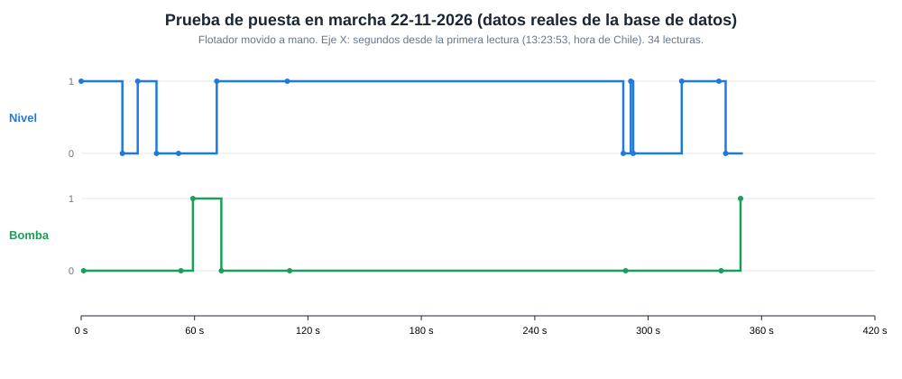

# Reporte de testing

## 1. Prueba exploratoria de puesta en marcha (22-11-2026)

**Qué se hizo:** con la placa conectada al WiFi y a Railway, se movió el flotador con la
mano durante unos 6 minutos (13:23 a 13:30, hora de Chile) y se revisaron el Monitor
Serie y la página publicada.

**Datos:** [`../datos/lecturas_2026-11-22.csv`](../datos/lecturas_2026-11-22.csv)
(34 lecturas: 13 de nivel, 8 de bomba y 13 de estado).

### Resultados

| Verificación | Resultado | Evidencia |
|---|---|---|
| El ESP32 se conecta al WiFi y envía a Railway | ✅ Los envíos responden `201` (`{"ok":true,"id":1}`, etc.) | Monitor Serie |
| Los datos quedan guardados en PostgreSQL | ✅ 34 filas en la tabla `lecturas` | Exportación JSON/CSV |
| La bomba no enciende de inmediato al marcar VACÍO | ✅ `estado` pasó a ESPERANDO ARRANQUE (16:24:43 UTC) y a ENCENDIDA unos 10 s después (16:24:53) | Filas 8 a 13 |
| La bomba se apaga al marcar LLENO | ✅ Nivel = 1 a las 16:25:04, `estado` = ESPERANDO CORTE (16:25:06), `bomba` = 0 (16:25:07) | Filas 14 a 16 |
| Descanso de 60 s después de cortar | ✅ `estado` = DESCANSO tras cada corte; el siguiente encendido fue recién a las 16:29:42 | Filas 17 a 33 |
| Oscilaciones del flotador no encienden la bomba | ✅ Entre 16:28:39 y 16:28:45 el nivel cambió 3 veces sin encender la bomba (estaba en DESCANSO) | Filas 21 a 25 |
| La página avisa si la placa deja de enviar | ✅ Al desconectar la placa, la página mostró **SIN SEÑAL** | [Captura](../../software/docs/img/dashboard_railway_2026-11-22.jpg) |

### Modos de falla encontrados durante la puesta en marcha

| Falla | Causa | Qué se hizo |
|---|---|---|
| La placa no se conectaba al WiFi | El nombre de red escrito en el código no existía en ese lugar | Se agregó una lista de redes (WiFiMulti) para que la placa use la que encuentre |
| Error al subir el código: *"This chip is ESP32, not ESP32-C3"* | Placa equivocada elegida en el Arduino IDE | Se documentó elegir siempre **ESP32 Dev Module** |
| `/api/salud` respondía `password authentication failed for user "CLICK_TO"` | Se copió la Service URI de Aiven antes de mostrar la contraseña | Se armó la URI con la contraseña real y se volvió a desplegar |
| `getaddrinfo ENOTFOUND base` | Se pegó en `DATABASE_URL` un texto que no era la URI completa | Se corrigió la variable en Railway |
| Las horas de la base no coinciden exactamente con el cambio | `creado_en` es la hora de llegada; cada envío tarda alrededor de 1,2 s y se envían de a uno | Se documentó en `captura_y_datos.md` |

### Limitaciones

- No fue un llenado real del estanque: el flotador se movió a mano.
- No hubo carga real en el relé (bomba conectada: **POR COMPLETAR** confirmar).
- Duró solo unos 6 minutos.

## 2. Pruebas formales (protocolo)

**POR COMPLETAR** al ejecutar [`protocolo_pruebas.md`](protocolo_pruebas.md):

| Prueba | Criterio de éxito | Resultado |
|---|---|---|
| A. Funcional (20 ciclos) | 20/20 correctos, encendido entre 10 y 12 s | |
| B. Conectividad y datos | ≥ 99 % de los datos en la base, aviso SIN SEÑAL ≤ 3 min | |
| C. Tiempos (10 mediciones) | Mediana ≤ 10 s | |

## 3. Validación contra el problema

**Problema (ODS 6):** en Culiprán y San Pedro (Melipilla) el agua se saca de pozo y se
guarda en estanques que rebalsan porque la bomba se apaga a mano, y se desperdicia agua.

| Pregunta | Prueba | Evidencia hasta ahora |
|---|---|---|
| ¿La bomba se apaga sola cuando el estanque se llena (no rebalsa)? | A | En la puesta en marcha, la bomba se apagó alrededor de 1 s después de que el flotador marcó LLENO (filas 14 a 16). Falta repetirlo 20 veces con agua real |
| ¿Se enciende sola cuando el estanque se vacía? | A | Encendió unos 10 s después de marcar VACÍO, como estaba programado (filas 8 a 13) |
| ¿La familia puede saber a distancia si hay agua? | B y C | La página pública mostró el nivel y la alerta SIN SEÑAL. Faltan las mediciones de tiempos |

**POR COMPLETAR:** conclusión final cuando terminen las pruebas A a C.
